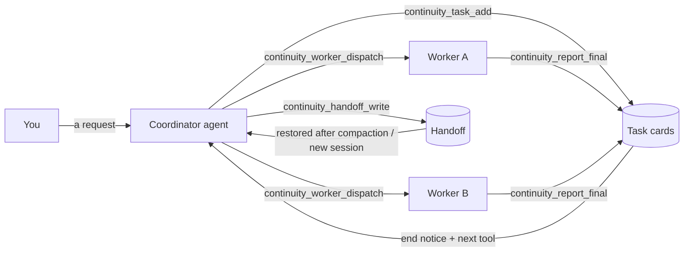

<div align="center">

# Continuity Plane

**Let several AI coding agents work on one project in relay: nothing gets lost, progress stays visible, and a new session picks up where the last one stopped.**

[](https://pypi.org/project/continuity-plane/) [](https://github.com/skyhua0224/continuity-plane/releases/latest) [](LICENSE) [](https://github.com/skyhua0224/continuity-plane)

[简体中文](README.md) | English

</div>

---

When you use agents such as Claude Code or Codex on anything larger than one change, the same problems keep coming back: the plan disappears when the context is compacted; the agents you sent off work in isolation and you cannot tell who has finished; reports are buried in logs; and every new session or model needs the whole story again.

Continuity keeps that story in one shared project record. **Task cards** say what each piece of work is, who does it and how it is checked. **Run records** show when each agent started, whether it is stuck and what it reported. **Handoffs** keep the coordinator's plan and open decisions. Agents read and write these records through MCP tools, and the plugins save and restore them at session start and around compaction, without you having to remind anyone.

It runs locally by default: no account, database or background service.

## ✨ Highlights

- **Task cards and to-dos** — split "fix A, test B, then document it" into cards for different agents or people; each card states the goal, the files it may touch and how it is checked, and to-do lists are generated from the cards
- **Dispatch and supervise agents** — one tool call sends a card to Codex or Claude in the background; Continuity records start, heartbeats, exit reason and final report, and attaches the report to the card
- **Told when work ends** — when a worker finishes, fails, is rate-limited or gets stuck, the coordinator sees it in the conversation together with the tool to call next, across every project it leads
- **Survives compaction and new sessions** — plugins save and restore "what comes next" at session start and around compaction; a new coordinator gets the plan, open decisions and approvals from the handoff
- **Agents use it without being told** — the MCP server explains itself, everyday operations are separate typed tools, dispatched workers are told which tools to call, and a shell detour gets one reminder
- **Read less code** — a local code index returns a few locations for a symbol, path or reverse dependency, about 1 KB by default and far smaller than a repository-wide grep
- **Shared rules and sources** — rules, terminology, reference documents and lessons are kept apart, and the matching rules travel with every dispatch
- **Usage you can see** — `continuity observe adoption` counts how each agent session reached Continuity, through MCP or the CLI, and which operations still go through the shell

<details>
<summary><strong>Cards, to-dos and handoffs</strong></summary>

- Card fields: title, body, objective, next action, exit criteria, assignee, lane, priority, allowed files, worktree, branch, commit, verification and final report
- Statuses: queued, dispatched, active, blocked, ready-for-review, completed, merged, rejected and superseded
- Dependencies: `--dependency` names prerequisite cards; `task list --dependencies-ready` lists only cards that can start
- To-dos: `todo from-cards` projects cards into a list per assignee, or a multi-part instruction can be compiled into a personal to-do list
- Handoffs: `handoff write` stores the plan, next action and open decisions; `handoff show` puts open decisions, blocked cards and failed runs first
- Shared backend: optionally use private Gitea Issues/PRs as the task source, with each member on their own CLI and MCP

</details>

<details>
<summary><strong>Dispatch, queues and quotas</strong></summary>

- Workers: Codex, Claude Code or any custom command; Continuity never stores or copies logins
- Preview before dispatch: the assembled prompt, rules, code pointers and checks, then start
- Supervision: heartbeats, idle time, timeouts, exit code, actual working directory and Git HEAD; leftovers from a crash or reboot can be listed and cleared
- Queue: work waits when capacity or quota is short, and one runner starts it in order; transient 429 and quota errors back off and retry
- Fallback: a project fallback only starts after the same model's transient retries are used up; authentication failures and content-policy refusals never switch channels automatically
- Resume: `worker resume` continues the native session, returning to the original thread once quota resets

</details>

<details>
<summary><strong>Hooks and MCP</strong></summary>

- Hooks: SessionStart, PreCompact, PostCompact, UserPromptSubmit, PostToolUse, Stop and SessionEnd; SubagentStart/SubagentStop on Claude Code and PreToolUse on Codex
- MCP: the `continuity` server provides cards, dispatch, waiting, reports and handoffs; `continuity-search` provides code lookup
- Remote: the coordinating machine and the state host can differ, with hooks and commands forwarded over SSH
- Metering: returned bytes, hook injections, host tokens and cache counts are kept apart; adoption counts store numbers, never conversation text

</details>

## 🧭 How it works



A typical run:

1. You give the coordinator a request. It splits it into cards with `continuity_task_add`, each saying what to do and how to check it.
2. `continuity_worker_dispatch` previews the dispatch; `launch=true` starts the worker in the background.
3. The coordinator waits with `continuity_events_wait`; when a worker in any of its projects ends, it gets the notice and the next step.
4. The worker finishes with `continuity_report_final`: report, commits and checks go onto the card, the card becomes ready for review, and the coordinator is told.
5. The coordinator reads the report and arranges review or merge. Before the context fills up it calls `continuity_handoff_write`, and the next session continues from there.

## 🚀 Quick start

Requires Python 3.11+ and Git.

```bash
pipx install 'continuity-plane==0.1.0a36'
continuity --version
cd your-repo
continuity collaboration register --project-id demo --control-root . --repository-root .
```

Then install the plugin for your agent (next section) and simply describe the work, for example "split these three things between two helpers; someone takes over tomorrow". To try a card by hand:

```bash
continuity collaboration task add --project-id demo --task-id first-card --lane-id main --mode patch --priority p1 --title 'Try a card' --objective 'Learn the flow' --next-action 'Read the card' --exit-criterion 'Visible in the list' --body 'Anything you want done'
continuity collaboration task list --project-id demo --format brief
```

Existing installs, venvs, Windows paths, upgrades and rollback: [deployment guide](docs/deployment.en.md).

## 🤖 Connect your agent

| Host | Install | What you get |
|---|---|---|
| Claude Code | `continuity-plane` plugin | Collaboration skill, all hooks, and the `continuity` and `continuity-search` MCP servers |
| Codex | Codex plugin `continuity-plane-state` | Card, dispatch, waiting and report MCP tools plus the collaboration skill |
| Codex | Codex plugin `continuity-plane-search` | Code lookup MCP tool |
| Codex | Codex plugin `continuity-plane` | Session and compaction hooks |
| Other stdio MCP clients | Add `continuity-mcp` and `continuity-search-mcp` | The same MCP tools |

```bash
claude plugin marketplace add skyhua0224/continuity-plane
claude plugin install continuity-plane@continuity-plane --scope user
codex plugin marketplace add skyhua0224/continuity-plane --ref v0.1.0-alpha.36
codex plugin add continuity-plane-state@continuity-plane
codex plugin add continuity-plane-search@continuity-plane
codex plugin add continuity-plane@continuity-plane
```

After an upgrade, reconnect MCP or start a new session so the host loads the new tools. In Codex, trust the new hook definitions under `/hooks`.

The MCP tools you will see most:

| When | Tool |
|---|---|
| Session start, after compaction, on a new assignment | `continuity_start` |
| Split, change or look at work | `continuity_task_add` · `continuity_task_update` · `continuity_task_list` · `continuity_task_show` |
| Send to a worker and wait | `continuity_worker_dispatch` → `continuity_events_wait` → `continuity_worker_report` |
| Worker reporting | `continuity_progress` · `continuity_report_final` · `continuity_review_request` |
| Handoff | `continuity_handoff_write` · `continuity_handoff_show` |
| Find code | `continuity_context_lookup` |
| Everything else (rules, sources, quota, queue, batches) | `continuity_plan(action=…)`, parameters from `continuity_help` |

Every command, parameter and hook: [command and tool reference](docs/commands.en.md).

## 📊 Measurements

Alpha36 against Alpha35. Methods, samples and commands are in the [Alpha36 notes](docs/release-alpha36.md).

**Real agent sessions** (Claude Code, Sonnet 5.5, 3 runs per scenario and version, prompts never mention Continuity)

| Scenario | Continuity operations via MCP | Median cost | Median tokens |
|---|---|---:|---:|
| Coordinator splits 3 tasks, assigns them, writes a handoff | 5–82 % → **100 %** | $0.185 → **$0.128** | 342,725 → **177,317** |
| Take over after compaction | 0 % → **100 %** | $0.063 → **$0.055** | 68,048 → 64,061 |

**Reads on a large project** (1,101 cards, 237k events; `hyperfine` 3×20 runs, median)

| Operation | Alpha35 | Alpha36 |
|---|---:|---:|
| Last 50 changes | 812 ms | **61 ms** |
| Coordinator handoff | 466 ms | **174 ms** |
| Cards awaiting review | 333 ms | **168 ms** |

**Code lookup** (807-file, ~115k-line C/C++ repository; 48 labelled queries + 8 held-out symbols)

| Metric | Alpha35 | Alpha36 |
|---|---:|---:|
| First result is the definition (labelled / held-out) | 13.8 % / 1 of 8 | **100 % / 7 of 8** |
| Warm lookup, in-process median | 589 ms | **84 ms** |

**Resuming after compaction** (simulated session: 30 prompts, 200 tool calls)

| Metric | Alpha35 | Alpha36 |
|---|---:|---:|
| Context injected after compaction | 3,974 B | **1,150 B** |
| Hook injection over the session | 7,792 B | **2,950 B** |
| Resume accuracy (active card, next step, constraints, open decisions, verification) | — | **5/5** |

Machine: Intel i7-13700KF (24 threads), 31 GB, Linux, Python 3.13/3.14. Earlier experiments: [historical experiments](docs/benchmarks.en.md).

## 📚 Documentation

| To | Read |
|---|---|
| Install, upgrade, plugins, several machines | [Deployment](docs/deployment.en.md) |
| Work alone, coordinate workers, work as a team | [Usage](USAGE.en.md) · [Workflows by role](docs/workflows.en.md) |
| Opening and closing conventions for agents | [Agent start](docs/agent-start.en.md) |
| Every command, parameter and hook | [Command and tool reference](docs/commands.en.md) |
| Restore plans and habits when the coordinator changes | [Controller continuity](docs/controller-memory.en.md) |
| Typical scenarios | [Use cases](docs/use-cases.en.md) |
| Progress on project views and graphical products | [Project views](docs/project-views.en.md) · [Visual products](docs/visual-products.en.md) |
| What is verified and what is not | [Validation matrix](docs/validation.en.md) |
| Version history | [Changelog](CHANGELOG.en.md) · [Releases](https://github.com/skyhua0224/continuity-plane/releases) |

## ⚠️ Known limits

- Cards record intent and facts; they never grant merge, push, deploy, paid-model or account access.
- `allowed-file` and the repository write guard prevent mistakes; they are not a security sandbox.
- Only workers dispatched through Continuity have full run records; a host's own sub-agents record start and stop only.
- Notices arrive on the next tool call or prompt; they cannot wake a closed session.
- Native Windows hooks, real multi-account quota and long two-machine waits still lack field verification; see the [validation matrix](docs/validation.en.md).

## 🐛 Feedback

When you open an [issue](https://github.com/skyhua0224/continuity-plane/issues), include `continuity --version`, the host (Claude Code/Codex and version), redacted commands and output, and steps to reproduce. Do not upload raw sessions, secrets or private project material.

## 📄 License

[Apache-2.0](LICENSE); attribution requirements in [NOTICE](NOTICE).
