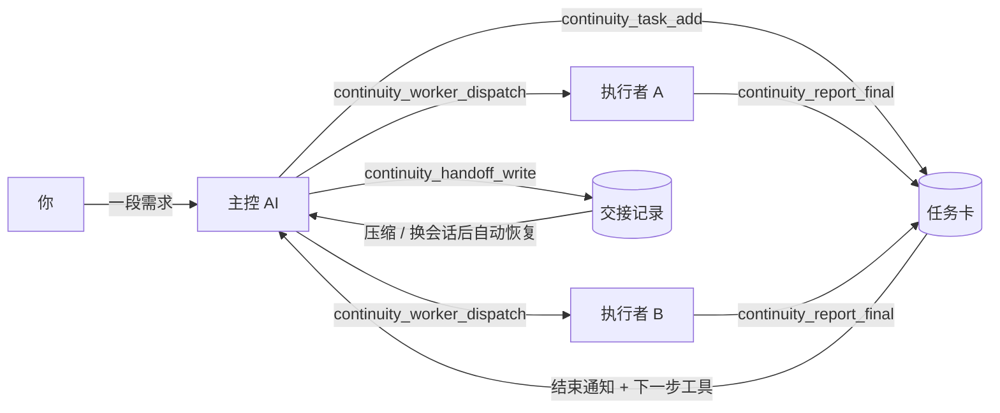

<div align="center">

# Continuity Plane

**让多个 AI 编程助手在同一个项目里接力干活：任务不丢、进度看得见、换会话也能接着做。**

[](https://pypi.org/project/continuity-plane/) [](https://github.com/skyhua0224/continuity-plane/releases/latest) [](LICENSE) [](https://github.com/skyhua0224/continuity-plane)

简体中文 | [English](README.en.md)

</div>

---

用 Claude Code、Codex 这类 AI 助手做大一点的活时，常见的麻烦是：上下文一压缩，计划和进度就没了；派出去的几个 AI 各干各的，不知道谁做完了；报告埋在日志里；换个会话或换个模型，又要从头讲一遍。

Continuity 把这些东西放进一份共享的项目记录：**任务卡**写清楚每件事做什么、谁来做、怎么验收；**执行记录**记下每个 AI 什么时候开始、有没有卡住、最后交了什么报告；**交接记录**保存主控的计划和待决事项。AI 通过 MCP 工具直接读写这些记录，插件在会话开始、上下文压缩前后自动保存和恢复，你不需要提醒它们。

默认只在本机运行，不需要账号、数据库或常驻服务。

## ✨ 核心特性

- **任务卡与待办** — 把“先修 A、再测 B、最后写说明”拆成任务卡，分给不同的 AI 或人；每张卡写明目标、允许改的文件和验收条件，待办清单直接由卡片生成
- **派发与监督 AI 执行者** — 一个工具调用把卡片交给 Codex 或 Claude 后台执行；Continuity 记录启动、心跳、退出原因和最终报告，报告自动挂回卡片
- **结束即通知** — 执行者完成、失败、被限流或卡住时，主控马上在对话里看到，并且附带下一步该调用的工具；覆盖主控负责的所有项目
- **压缩和换会话不丢进度** — 插件在会话开始、压缩前后自动保存和恢复“接下来做什么”；换主控时，交接记录保留计划、待决事项和批准来源
- **Agent 默认就会用** — MCP 服务器自带使用说明，常用操作是独立的类型化工具；派发给执行者的提示词直接写明该调用哪个工具；在 shell 里绕路时会被提醒一次
- **少读代码** — 本地代码索引按符号、路径或反向依赖返回几条位置，默认约 1 KB，比全仓库 grep 小得多
- **共享规则和资料** — 规则、术语、参考文档、踩坑教训分开记录，派发时自动带上对应规则
- **用量看得见** — `continuity observe adoption` 统计每个 AI 会话通过 MCP 和 CLI 使用 Continuity 的次数，哪些操作还在走 shell 一目了然

<details>
<summary><strong>任务卡、待办与交接</strong></summary>

- 卡片字段：标题、正文、目标、下一步、验收条件、负责人、泳道、优先级、允许修改的文件、worktree、分支、提交、验证记录和最终报告
- 状态：queued、dispatched、active、blocked、ready-for-review、completed、merged，以及 rejected、superseded
- 依赖：`--dependency` 声明前置卡片，`task list --dependencies-ready` 只列可以开工的卡
- 待办：`todo from-cards` 按负责人把卡片投影成清单；也可以把一段多事项指令直接编译成个人待办
- 交接：`handoff write` 保存当前计划、下一步、待决事项；`handoff show` 优先展示待决事项、阻塞卡和失败的运行
- 共享后端：可选私有 Gitea Issue／PR 作为任务来源，各成员用本机 CLI 和 MCP 访问

</details>

<details>
<summary><strong>执行者派发、队列与额度</strong></summary>

- 执行者配置：Codex、Claude Code 或任意自定义命令；Continuity 不保存也不复制登录信息
- 派发前预览：组装好的提示词、规则、代码路标和检查结果，确认后再启动
- 后台监督：心跳、无输出时长、超时、退出码、实际工作目录和 Git HEAD；崩溃或重启后可列出并清理遗留记录
- 队列：容量或额度不够时排队，单实例 runner 依次启动；临时 429／额度错误自动退避重试
- 回退策略：项目级 fallback 只在同一模型的临时重试用完后启用；认证失败和内容策略拒绝不会自动换渠道
- 续跑：`worker resume` 继续原生会话；模型额度恢复后优先回到原线程

</details>

<details>
<summary><strong>Hooks 与 MCP</strong></summary>

- Hooks：SessionStart、PreCompact、PostCompact、UserPromptSubmit、PostToolUse、Stop、SessionEnd；Claude Code 另有 SubagentStart／SubagentStop，Codex 另有 PreToolUse
- MCP：`continuity` 服务器提供任务、派发、等待、报告、交接等工具；`continuity-search` 提供代码检索
- 远程：控制端和状态端可以分在两台机器，通过 SSH 转发 hooks 和命令
- 计量：区分实际返回字节、hook 注入、宿主 token 和缓存计数；采用率统计只记次数，不存会话内容

</details>

## 🧭 工作方式



一个典型的过程：

1. 你给主控一段需求。主控用 `continuity_task_add` 拆成几张卡，写清楚每张卡做什么、怎么验收。
2. `continuity_worker_dispatch` 先预览，再 `launch=true` 交给执行者后台运行。
3. 主控调用 `continuity_events_wait` 等待；任何项目的执行者结束，主控都会收到通知和下一步建议。
4. 执行者干完活，调用 `continuity_report_final`：报告、提交和检查结果写回卡片，卡片标为待评审，并通知主控。
5. 主控读报告、安排评审或合入。上下文快满时 `continuity_handoff_write`，下一个会话自动接上。

## 🚀 快速开始

需要 Python 3.11+ 和 Git。

```bash
pipx install 'continuity-plane==0.1.0a36'
continuity --version
cd your-repo
continuity collaboration register --project-id demo --control-root . --repository-root .
```

然后在 AI 助手里装上插件（见下一节），直接说需求就行，例如“把这三件事拆给两个助手做，明天有人接手”。不习惯让 AI 自己管时，也可以手动建一张卡看看：

```bash
continuity collaboration task add --project-id demo --task-id first-card --lane-id main --mode patch --priority p1 --title '试一张卡' --objective '熟悉流程' --next-action '读卡片' --exit-criterion '能在列表里看到' --body '随便写点要做的事'
continuity collaboration task list --project-id demo --format brief
```

已有环境、venv、Windows 路径、升级和回滚见[部署说明](docs/deployment.md)。

## 🤖 接入 AI 助手

| 宿主 | 安装 | 得到什么 |
|---|---|---|
| Claude Code | `continuity-plane` 插件 | 协作 skill、全部 hooks、`continuity` 与 `continuity-search` 两个 MCP 服务器 |
| Codex | Codex plugin `continuity-plane-state` | 任务、派发、等待、报告等 MCP 工具和协作 skill |
| Codex | Codex plugin `continuity-plane-search` | 代码检索 MCP 工具 |
| Codex | Codex plugin `continuity-plane` | 会话与压缩 hooks |
| 其他 stdio MCP 客户端 | 手动添加 `continuity-mcp`、`continuity-search-mcp` | 同样的 MCP 工具 |

```bash
claude plugin marketplace add skyhua0224/continuity-plane
claude plugin install continuity-plane@continuity-plane --scope user
codex plugin marketplace add skyhua0224/continuity-plane --ref v0.1.0-alpha.36
codex plugin add continuity-plane-state@continuity-plane
codex plugin add continuity-plane-search@continuity-plane
codex plugin add continuity-plane@continuity-plane
```

升级后需要重连 MCP 或新开会话，宿主才会加载新工具。Codex 安装插件后要在 `/hooks` 里信任新的 hook 定义。

最常用的 MCP 工具：

| 什么时候 | 工具 |
|---|---|
| 会话开始、压缩之后、收到任务 | `continuity_start` |
| 拆分、修改、查看任务 | `continuity_task_add` · `continuity_task_update` · `continuity_task_list` · `continuity_task_show` |
| 派给执行者并等待 | `continuity_worker_dispatch` → `continuity_events_wait` → `continuity_worker_report` |
| 执行者汇报 | `continuity_progress` · `continuity_report_final` · `continuity_review_request` |
| 交接 | `continuity_handoff_write` · `continuity_handoff_show` |
| 找代码 | `continuity_context_lookup` |
| 其他操作（规则、资料、额度、队列、批次） | `continuity_plan(action=…)`，参数用 `continuity_help` 查 |

完整的命令、参数和 hooks 说明见[命令与工具参考](docs/commands.md)。

## 📊 实测数据

以下是 Alpha36 与 Alpha35 的对照，测量方法、样本和原始命令见 [Alpha36 说明](docs/release-alpha36.md)。

**真实 Agent 会话**（Claude Code，Sonnet 5.5，每个场景每版 3 次，用户提示不提 Continuity）

| 场景 | Continuity 操作走 MCP | 中位成本 | 中位 token |
|---|---|---:|---:|
| 主控拆分 3 件事、分派、写交接 | 5–82 % → **100 %** | $0.185 → **$0.128** | 342,725 → **177,317** |
| 压缩后接手 | 0 % → **100 %** | $0.063 → **$0.055** | 68,048 → 64,061 |

**大项目读取速度**（1,101 张卡、23.7 万条事件；`hyperfine` 3×20 次，中位数）

| 操作 | Alpha35 | Alpha36 |
|---|---:|---:|
| 读取最近 50 条变更 | 812 ms | **61 ms** |
| 读取主控交接 | 466 ms | **174 ms** |
| 列出待评审的卡 | 333 ms | **168 ms** |

**代码定位**（807 个文件、约 11.5 万行的 C/C++ 仓库，48 条标注查询 + 8 个复核符号）

| 指标 | Alpha35 | Alpha36 |
|---|---:|---:|
| 第一条结果就是定义（标注集 / 复核集） | 13.8 % / 1 of 8 | **100 % / 7 of 8** |
| 热缓存查询，进程内中位数 | 589 ms | **84 ms** |

**压缩后接续**（30 次提问、200 次工具调用的模拟会话）

| 指标 | Alpha35 | Alpha36 |
|---|---:|---:|
| 压缩后注入上下文 | 3,974 B | **1,150 B** |
| 整个会话的 hook 注入 | 7,792 B | **2,950 B** |
| 恢复准确度（当前卡、下一步、约束、待决事项、验证入口） | — | **5/5** |

测试机：Intel i7-13700KF（24 线程）、31 GB、Linux、Python 3.13/3.14。更早版本的实验见[历史实验](docs/benchmarks.md)。

## 📚 文档

| 想做什么 | 看这里 |
|---|---|
| 安装、升级、插件、多台机器 | [部署说明](docs/deployment.md) |
| 一个人用、主控带执行者、团队协作 | [使用说明](USAGE.md) · [按角色的工作流](docs/workflows.md) |
| 给 AI 的开工与收尾约定 | [开工指南](docs/agent-start.md) |
| 所有命令、参数、hooks | [命令与工具参考](docs/commands.md) |
| 换主控时恢复计划和习惯 | [主控连续性](docs/controller-memory.md) |
| 典型使用场景 | [使用场景](docs/use-cases.md) |
| 项目视图与图形界面的进度 | [项目视图](docs/project-views.md) · [图形产品](docs/visual-products.md) |
| 已验证的能力和已知限制 | [验证矩阵](docs/validation.md) |
| 版本变化 | [变更记录](CHANGELOG.md) · [Releases](https://github.com/skyhua0224/continuity-plane/releases) |

## ⚠️ 已知限制

- 任务卡记录的是意图和事实，不授予合并、推送、部署、付费模型或账号权限。
- `allowed-file` 和仓库写保护用来防止误操作，不是安全沙箱。
- 只有通过 Continuity 派发的执行者才有完整的运行记录；宿主自己的子代理只记录开始和结束。
- 通知在下一次工具调用或提问时送达，不能唤醒已经关闭的会话。
- Windows 原生 hooks、真实多账号额度和双机长时间等待还缺少现场验证，见[验证矩阵](docs/validation.md)。

## 🐛 反馈

提交 [Issue](https://github.com/skyhua0224/continuity-plane/issues) 时请附上：`continuity --version`、宿主（Claude Code／Codex 及版本）、脱敏后的命令和输出、复现步骤。不要上传原始会话、密钥或私有项目资料。

## 📄 许可证

[Apache-2.0](LICENSE)，归属要求见 [NOTICE](NOTICE)。
